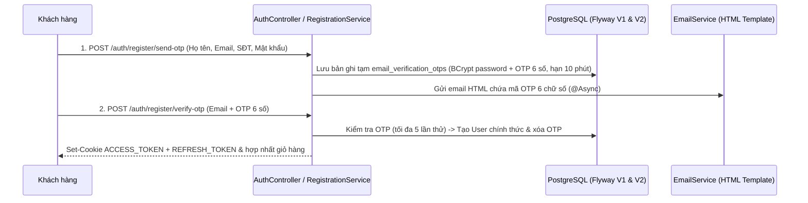
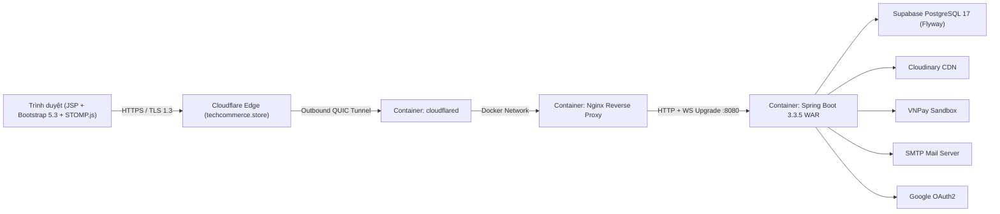

<div align="center"><a name="readme-top"></a>

<a href="https://techcommerce.store">
  
</a>

**Hệ thống Thương mại Điện tử Chuỗi Cửa hàng Công nghệ Đa Chi nhánh**

Đồng bộ tồn kho thực tế 3 miền (Hà Nội · TP.HCM · Đà Nẵng), đặt giữ hàng nhận tại quầy sau 15 phút,<br/>
thanh toán COD & VNPay, theo dõi tiến trình đơn hàng qua WebSocket và đổi trả trực tuyến trong 7 ngày.

**Tiếng Việt** · [Website Chính thức][official-site] · [Kiến trúc Chi tiết][plan-doc] · [Danh sách 21 Tác vụ][todo-doc] · [Nguyên tắc Dùng AI][contributing-doc] · [Báo lỗi / Issues][github-issues-link]

<!-- SHIELD GROUP -->

[![][site-shield]][official-site]
[![][springboot-shield]][springboot-link]
[![][java-shield]][java-link]
[![][postgres-shield]][postgres-link]
[![][docker-shield]][docker-link]<br/>
[![][github-action-ci-shield]][github-action-ci-link]
[![][github-action-cd-shield]][github-action-cd-link]
[![][sitemesh-shield]][official-site]
[![][cloudflare-shield]][official-site]<br/>
[![][github-contributors-shield]][github-contributors-link]
[![][github-forks-shield]][github-forks-link]
[![][github-stars-shield]][github-stars-link]
[![][github-issues-shield]][github-issues-link]
[![][github-license-shield]][github-license-link]

</div>

<br/>

<details>
<summary><kbd>Mục lục (Table of contents)</kbd></summary>

#### TOC

- [👋🏻 Giới thiệu & Trải nghiệm Nhanh](#-giới-thiệu--trải-nghiệm-nhanh)
- [✨ Tính năng Cốt lõi & Kiến trúc](#-tính-năng-cốt-lõi--kiến-trúc)
  - [Từ khách vãng lai đến điều hành chuỗi đa chi nhánh](#từ-khách-vãng-lai-đến-điều-hành-chuỗi-đa-chi-nhánh)
  - [`Tầng 1` Chọn Showroom & Đồng bộ tồn kho 3 miền](#tầng-1-chọn-showroom--đồng-bộ-tồn-kho-3-miền)
  - [`Tầng 2` Xác thực JWT HttpOnly, Google OAuth2 & OTP Email](#tầng-2-xác-thực-jwt-httponly-google-oauth2--otp-email)
  - [`Tầng 3` Đặt hàng, Thanh toán VNPay & Theo dõi Realtime](#tầng-3-đặt-hàng-thanh-toán-vnpay--theo-dõi-realtime)
  - [`Tầng 4` Luồng Triển khai Cloudflare Tunnel & Cơ sở dữ liệu](#tầng-4-luồng-triển-khai-cloudflare-tunnel--cơ-sở-dữ-liệu)
- [🧩 Ngăn xếp Công nghệ](#-ngăn-xếp-công-nghệ)
- [📖 Tài liệu, Đường dẫn & Tài khoản Kiểm thử](#-tài-liệu-đường-dẫn--tài-khoản-kiểm-thử)
- [🛳 Triển khai Production & CI/CD (Self-Hosting)](#-triển-khai-production--cicd-self-hosting)
  - [`A` Docker Compose + Cloudflare Named Tunnel](#a-docker-compose--cloudflare-named-tunnel)
  - [`B` GitHub Actions CI/CD & Self-Hosted Runner](#b-github-actions-cicd--self-hosted-runner)
- [⌨️ Cài đặt & Phát triển trên Máy Cá nhân (Local Dev)](#️-cài-đặt--phát-triển-trên-máy-cá-nhân-local-dev)
- [🤝 Phân công Nhóm & Nguyên tắc Đóng góp](#-phân-công-nhóm--nguyên-tắc-đóng-góp)

####

<br/>

</details>

<br/>

## 👋🏻 Giới thiệu & Trải nghiệm Nhanh

**TechCommerce** là nền tảng bán lẻ thiết bị phần cứng (Laptop, Workstation, Điện thoại, Linh kiện PC) xây dựng theo kiến trúc **Modular Monolith** trên nền **Spring Boot 3.3.5 (Executable WAR) + JSP/JSTL 3.0 + SiteMesh 3.2.2 + PostgreSQL 17**.

| [![][live-demo-badge]][official-site] | Hệ thống đang vận hành trực tuyến tại **https://techcommerce.store** qua Cloudflare Named Tunnel, Nginx Reverse Proxy và cơ sở dữ liệu Supabase PostgreSQL. |
| :----------------------------------- | :----------------------------------------------------------------------------------------------------------------------------------------------------------- |
| [![][ai-guide-badge]][contributing-doc] | Sử dụng AI (ChatGPT, Claude, Gemini, Cursor) để viết code? Đọc ngay **[CONTRIBUTING.md](./CONTRIBUTING.md)** để tuân thủ chuẩn Jakarta EE 10, Flyway và CSRF. |

> [!IMPORTANT]
>
> **Kiểm thử nhanh trên trang đăng nhập**: Truy cập [`/auth/login`](https://techcommerce.store/auth/login) và nhấn các nút **Điền nhanh tài khoản mẫu (Demo)** (`Admin chuỗi`, `Staff Hà Nội`, `Staff TP.HCM`, `Khách hàng`) với mật khẩu chung `Password123!`.

<div align="right">

[![][back-to-top]](#readme-top)

</div>

## ✨ Tính năng Cốt lõi & Kiến trúc

<div align="center">

### Từ khách vãng lai đến điều hành chuỗi đa chi nhánh

Thiết kế đồng bộ bằng **Google Stitch Design System v3.0**, tách biệt rõ giao diện Khách hàng, Khung xác thực và Trung tâm vận hành.

<sub>4 TRỤ CỘT KỸ THUẬT CỦA TECHCOMMERCE</sub>

</div>

<table>
  <tr>
    <td width="50%" valign="top">
      <b>🏬 Đồng bộ tồn kho 3 miền</b><br/>
      Chuyển đổi tức thì giữa <code>Toàn hệ thống</code>, <code>HN-01</code> (Hà Nội), <code>HCM-01</code> (TP.HCM) và <code>DN-01</code> (Đà Nẵng) qua cookie <code>SELECTED_STORE_ID</code>.
    </td>
    <td width="50%" valign="top">
      <b>🔐 Bảo mật JWT + OAuth2 + OTP Email</b><br/>
      Access Token &amp; Refresh Token xoay vòng trong HttpOnly Cookie, đăng nhập Google OAuth2, đăng ký xác thực mã OTP 6 chữ số qua email HTML và khóa chống dò mật khẩu.
    </td>
  </tr>
  <tr>
    <td width="50%" valign="top">
      <b>⚡ Nhận tại quầy 15 phút &amp; VNPay</b><br/>
      Hợp nhất giỏ hàng khách vãng lai khi đăng nhập, áp dụng mã giảm giá theo chuỗi/chi nhánh, thanh toán COD hoặc VNPay Sandbox (HMAC-SHA512).
    </td>
    <td width="50%" valign="top">
      <b>📡 WebSocket Realtime &amp; Đổi trả 7 ngày</b><br/>
      Cập nhật tiến trình đơn hàng trực tiếp qua STOMP WebSocket, chat 1-1 với nhân viên showroom và gửi yêu cầu đổi trả kèm ảnh minh chứng Cloudinary.
    </td>
  </tr>
</table>

### `Tầng 1` Chọn Showroom & Đồng bộ tồn kho 3 miền

Khách hàng chọn chi nhánh ngay trên thanh điều hướng Dark Obsidian hoặc tại danh bạ [`/stores`](https://techcommerce.store/stores). Mọi truy vấn tồn kho biến thể SKU, cảnh báo sắp hết hàng và đăng ký nhận email khi có hàng lại đều bám theo showroom đang chọn.

```mermaid
flowchart LR
    User["Khách hàng"] -->|"GET /stores/select?storeId=1"| StoreCtrl["StoreController"]
    StoreCtrl -->|"Set-Cookie: SELECTED_STORE_ID=1"| Browser["Trình duyệt"]
    Browser -->|"Mọi request tiếp theo"| Advice["CurrentUserAdvice (@ControllerAdvice)"]
    Advice -->|"Inject ${currentStore} & ${activeStores}"| Decorator["SiteMesh web.jsp & Các trang JSP"]
```

<div align="right">

[![][back-to-top]](#readme-top)

</div>

### `Tầng 2` Xác thực JWT HttpOnly, Google OAuth2 & OTP Email

Không lưu JWT trong `localStorage`. Hệ thống cấp cặp `ACCESS_TOKEN` (15 phút) và `REFRESH_TOKEN` (7 ngày, lưu bản băm SHA-256 trong bảng `refresh_tokens`) qua `HttpOnly Cookie`. Khi Admin khóa tài khoản hoặc người dùng đổi mật khẩu, toàn bộ phiên hoạt động bị thu hồi ngay mà không cần Redis.



<div align="right">

[![][back-to-top]](#readme-top)

</div>

### `Tầng 3` Đặt hàng, Thanh toán VNPay & Theo dõi Realtime

Tồn kho từng chi nhánh được bảo vệ ở mức cơ sở dữ liệu bằng ràng buộc `UNIQUE(store_id, variant_id)` và `CHECK (quantity >= 0)`. Đơn thanh toán VNPay quá hạn 15 phút chưa thanh toán sẽ được tác vụ định kỳ thu hồi để hoàn trả tồn kho cho chi nhánh.

<div align="right">

[![][back-to-top]](#readme-top)

</div>

### `Tầng 4` Luồng Triển khai Cloudflare Tunnel & Cơ sở dữ liệu



<div align="right">

[![][back-to-top]](#readme-top)

</div>

## 🧩 Ngăn xếp Công nghệ

Toàn bộ thư viện được khóa chặt trong [`pom.xml`](./pom.xml) để đảm bảo tính ổn định giữa môi trường máy cá nhân, CI container và máy chủ production:

| Thành phần | Công nghệ & Phiên bản | Vai trò trong hệ thống |
| :--- | :--- | :--- |
| **Runtime & Packaging** | Java 17 / 21 · Maven Wrapper · `war` | Đóng gói Executable WAR hỗ trợ biên dịch JSP qua Embedded Tomcat Jasper |
| **Backend Framework** | Spring Boot `3.3.5` (Web, Data JPA, Security, OAuth2, Validation, Mail, WebSocket) | Xử lý nghiệp vụ, bảo mật phân quyền, gửi mail bất đồng bộ và tác vụ nền |
| **Giao diện & Layout** | JSP · Jakarta JSTL `3.0` · SiteMesh `3.2.2` | Render HTML phía server, tách biệt 3 khung layout `web.jsp`, `auth.jsp`, `admin.jsp` |
| **Design System** | Bootstrap `5.3.3` · Bootstrap Icons `1.11.3` · Google Stitch v3.0 | Hệ thống token màu sắc, bảng biểu `tabular-nums`, font `Be Vietnam Pro` & `JetBrains Mono` |
| **Cơ sở dữ liệu** | PostgreSQL `17` (Supabase) · Flyway · H2 (Test) | Quản lý phiên bản schema tự động (`V1`, `V2`), kiểm thử tự động trên H2 in-memory |
| **Xác thực & Phiên** | `jjwt 0.12.6` · Google OAuth2 Client · BCrypt | Xác thực không trạng thái kết hợp xoay vòng Refresh Token trong PostgreSQL |
| **Hạ tầng & DevOps** | Docker Compose · Nginx · Cloudflare Named Tunnel · GitHub Actions | Tự động chạy 30 test, build image đẩy lên GHCR và cập nhật container qua Self-Hosted Runner |

<div align="right">

[![][back-to-top]](#readme-top)

</div>

## 📖 Tài liệu, Đường dẫn & Tài khoản Kiểm thử

### 1. Tài liệu kỹ thuật trong kho mã nguồn

| Tài liệu | Nội dung chi tiết |
| :--- | :--- |
| [**`tasks/plan.md`**](./tasks/plan.md) | Kiến trúc hệ thống, sơ đồ ER cơ sở dữ liệu, quy ước bảng và thiết kế module |
| [**`tasks/todo.md`**](./tasks/todo.md) | Danh sách 21 hạng mục công việc chia theo 5 giai đoạn kèm tiêu chí nghiệm thu |
| [**`CONTRIBUTING.md`**](./CONTRIBUTING.md) | Nguyên tắc bắt buộc khi dùng AI viết code, checklist trước khi mở Pull Request |
| [**`.env.example`**](./.env.example) | Danh mục đầy đủ các biến môi trường cần thiết cho Local Dev và Production |

### 2. Danh sách đường dẫn (Routes) đang hoạt động

| Đường dẫn | Quyền truy cập | Mô tả chức năng |
| :--- | :--- | :--- |
| `/` hoặc `/health-jsp` | Công khai | Trang chủ Storefront, thanh tìm kiếm trung tâm, danh mục phần cứng và lưới chọn nhanh 3 chi nhánh |
| `/stores` | Công khai | Danh bạ chi tiết 3 showroom (`HN-01`, `HCM-01`, `DN-01`), giờ mở cửa và hotline |
| `/stores/select?storeId={id}` | Công khai | Đặt cookie chi nhánh đang chọn (`code=ALL` để quay về Toàn hệ thống) |
| `/auth/login` | Công khai | Đăng nhập Email/Mật khẩu, Google OAuth2 (`prompt=select_account consent`) và hộp **Điền nhanh tài khoản mẫu** |
| `/auth/register` | Công khai | Bước 1 đăng ký tài khoản khách hàng (`CUSTOMER`) và gửi mã OTP 6 số qua email |
| `/auth/register/verify-otp` | Công khai | Bước 2 xác thực mã OTP 6 chữ số để kích hoạt tài khoản `CUSTOMER` |
| `/auth/forgot-password` | Công khai | Yêu cầu gửi liên kết đặt lại mật khẩu dùng 1 lần (hiệu lực 15 phút) |
| `/profile` | Đã đăng nhập | Cập nhật hồ sơ, đổi mật khẩu/đặt mật khẩu cho tài khoản Google, quản lý sổ địa chỉ (tối đa 5) |
| `/admin/dashboard` | `ADMIN`, `STAFF` | Trung tâm Vận hành Chi nhánh: hiển thị showroom được phân công của nhân viên và điều hướng nghiệp vụ chi nhánh |
| `/admin/users` | Chỉ `ADMIN` | Quản trị nhân sự toàn chuỗi: thống kê tài khoản, **cấp tài khoản `STAFF` mới gán theo chi nhánh**, khóa/mở khóa tài khoản |
| `/api/health` | Công khai | Endpoint JSON kiểm tra trạng thái sống của container (`{"status":"UP"}`) |

> [!NOTE]
>
> **Quy định cấp tài khoản nhân viên (`STAFF`)**: Trang đăng ký công khai (`/auth/register`) và Google OAuth2 chỉ khởi tạo tài khoản Khách hàng (`CUSTOMER`). Tài khoản Nhân viên chi nhánh (`STAFF`) bắt buộc gắn với một showroom hợp lệ (`chk_users_staff_store`) và **chỉ được tạo trực tiếp bởi `ADMIN`** tại `/admin/users`.

### 3. Tài khoản mẫu phục vụ chấm điểm & kiểm thử

Mật khẩu dùng chung cho cả 4 tài khoản mẫu: **`Password123!`**

| Email đăng nhập | Vai trò | Chi nhánh gắn kèm | Quyền hạn chính |
| :--- | :--- | :--- | :--- |
| `admin@techcommerce.store` | `ADMIN` | Toàn hệ thống | Toàn quyền quản trị chuỗi, cấp tài khoản Staff, khóa tài khoản |
| `staff.hn@techcommerce.store` | `STAFF` | `HN-01` (Hà Nội) | Vận hành đơn hàng, tồn kho và hỗ trợ khách tại showroom Hà Nội |
| `staff.hcm@techcommerce.store` | `STAFF` | `HCM-01` (TP.HCM) | Vận hành đơn hàng, tồn kho và hỗ trợ khách tại showroom TP.HCM |
| `customer@techcommerce.store` | `CUSTOMER` | Khách mua lẻ | Quản lý sổ địa chỉ, đặt hàng, đánh giá và gửi yêu cầu đổi trả |

<div align="right">

[![][back-to-top]](#readme-top)

</div>

## 🛳 Triển khai Production & CI/CD (Self-Hosting)

### `A` Docker Compose + Cloudflare Named Tunnel

[![][docker-shield]][docker-link]
[![][cloudflare-shield]][official-site]

Môi trường production được định nghĩa trong [`docker-compose.prod.yml`](./docker-compose.prod.yml), bao gồm 3 container: `app` (Spring Boot WAR), `nginx` (Reverse Proxy hỗ trợ WebSocket Upgrade) và `cloudflared` (đường hầm kết nối ra Cloudflare Edge, không cần mở port modem/router).

```bash
# Khởi động toàn bộ cụm container production
docker compose -p techcommerce-prod -f docker-compose.prod.yml --env-file .env.prod up -d --remove-orphans

# Theo dõi nhật ký ứng dụng theo thời gian thực
docker compose -p techcommerce-prod -f docker-compose.prod.yml logs -f app
```

### `B` GitHub Actions CI/CD & Self-Hosted Runner

- **Luồng CI ([`.github/workflows/ci.yml`](./.github/workflows/ci.yml))**: Tự động kích hoạt khi đẩy code lên `develop` hoặc mở Pull Request vào `main`/`develop`. Chạy toàn bộ unit & integration tests và kiểm tra đóng gói Docker image.
- **Luồng CD ([`.github/workflows/cd.yml`](./.github/workflows/cd.yml))**: Tự động kích hoạt khi đẩy code lên `main`. Sau khi vượt qua bộ test, GitHub Actions build image đẩy lên `ghcr.io/tbl251/techcommerce` và giao cho **Self-Hosted Runner** trên máy chủ kéo image mới về khởi động lại container.

<div align="right">

[![][back-to-top]](#readme-top)

</div>

## ⌨️ Cài đặt & Phát triển trên Máy Cá nhân (Local Dev)

**Yêu cầu cài đặt sẵn:** JDK 17 hoặc 21 · Docker Desktop · Git.

```bash
# 1. Sao chép kho mã nguồn
git clone https://github.com/TBL251/TechCommerce.git
cd TechCommerce

# 2. Tạo tệp biến môi trường từ bản mẫu
cp .env.example .env

# 3. Khởi động PostgreSQL 16 local (cổng 5432) và Mailpit SMTP test (cổng 1025 / giao diện web 8025)
docker compose up -d

# 4. Chạy bộ kiểm thử tự động (30 tests trên H2 in-memory, bao gồm kiểm tra đồng bộ .env.example)
./mvnw test

# 5. Khởi động ứng dụng ở cổng 8080 (tự động cảnh báo nếu .env thiếu biến mới và hỗ trợ hot-reload JSP)
./mvnw spring-boot:run
```

- Trang chủ ứng dụng: <http://localhost:8080>
- Hộp thư Mailpit (xem email OTP và khôi phục mật khẩu khi dev offline): <http://localhost:8025>

<div align="right">

[![][back-to-top]](#readme-top)

</div>

## 🤝 Phân công Nhóm & Nguyên tắc Đóng góp

> [!TIP]
>
> Trước khi dùng công cụ AI để sinh mã hoặc mở Pull Request mới, hãy đọc kỹ **[CONTRIBUTING.md](./CONTRIBUTING.md)**.
> Mọi thay đổi bắt buộc vượt qua `./mvnw test` (**30/30 xanh**), dùng gói `jakarta.*` (không dùng `javax.*`), đính kèm CSRF token trong mọi biểu mẫu `POST` và tuyệt đối không sửa nội dung các tệp Flyway migration cũ (`V1`, `V2`).

### 1. Bảng phân công 4 thành viên

| Mã TV | Vai trò & Phân hệ phụ trách | Các hạng mục chính trong [`tasks/todo.md`](./tasks/todo.md) |
| :--- | :--- | :--- |
| **`TV1`** | **Tech Lead · Auth · Layout · DevOps** | Khởi tạo Spring Boot WAR, Flyway `V1`–`V2`, SiteMesh 3, Google Stitch UI v3.0, JWT + Google OAuth2 + OTP Email, Sổ địa chỉ, Quản trị User/Staff, Docker, Nginx, Cloudflare Tunnel, CI/CD |
| **`TV2`** | **Chi nhánh · Catalog · Tồn kho · Voucher** | Quản lý chi nhánh, Danh mục/Thương hiệu/Sản phẩm (`JSONB` specs), Tìm kiếm không dấu, Tồn kho theo chi nhánh, Báo có hàng lại, So sánh cấu hình, Yêu thích, Voucher |
| **`TV3`** | **Giỏ hàng · Đặt hàng · Quản lý đơn · VNPay** | Giỏ hàng khách & thành viên, Mua sau, Đặt hàng nhận tại quầy / giao tận nơi, VNPay Sandbox, Tự hủy đơn treo quá 15 phút, Quy trình xử lý đơn và Đổi trả 7 ngày |
| **`TV4`** | **WebSocket · Chat · Đánh giá · Báo cáo** | Thông báo tiến trình đơn hàng realtime qua STOMP, Chat trực tiếp khách – chi nhánh, Đánh giá kèm ảnh thực tế, Hỏi đáp Q&A và Biểu đồ báo cáo doanh thu Chart.js |

### 2. Quy ước nhánh và Commit Git

- **`main`**: Nhánh sản phẩm ổn định (tự động kích hoạt pipeline CD deploy lên `https://techcommerce.store`).
- **`develop`**: Nhánh tích hợp chung của nhóm 4 thành viên.
- **`feature/<ten-tinh-nang>`** / **`fix/<ten-loi>`**: Nhánh làm việc cá nhân tách từ `develop`.
- Định dạng commit theo chuẩn **Conventional Commits** bằng tiếng Việt: `feat(auth): ...`, `fix(store): ...`, `docs: ...`, `test(store): ...`.

[![][pr-welcome-shield]][pr-welcome-link]
[![][ai-rules-shield]][contributing-doc]

<a href="https://github.com/TBL251/TechCommerce/graphs/contributors" target="_blank">
  
</a>

<div align="right">

[![][back-to-top]](#readme-top)

</div>

---

Copyright © 2026 **TechCommerce Team** ([TBL251/TechCommerce][repo-link]).

<!-- LINK GROUP -->

[ai-guide-badge]: https://img.shields.io/badge/AI_CODING_RULES-CONTRIBUTING.MD-0f52ba?labelColor=black&style=for-the-badge&logo=bookstack&logoColor=white
[ai-rules-shield]: https://img.shields.io/badge/🤖_nguyên_tắc_dùng_AI-%E2%86%92-95f3d9?labelColor=black&style=for-the-badge
[back-to-top]: https://img.shields.io/badge/-LÊN_ĐẦU_TRANG-151515?style=flat-square
[cloudflare-shield]: https://img.shields.io/badge/cloudflare_tunnel-techcommerce.store-F38020?labelColor=black&logo=cloudflare&logoColor=white&style=flat-square
[contributing-doc]: ./CONTRIBUTING.md
[docker-link]: https://www.docker.com/
[docker-shield]: https://img.shields.io/badge/docker-ready-369eff?labelColor=black&logo=docker&logoColor=white&style=flat-square
[github-action-cd-link]: https://github.com/TBL251/TechCommerce/actions/workflows/cd.yml
[github-action-cd-shield]: https://img.shields.io/github/actions/workflow/status/TBL251/TechCommerce/cd.yml?label=deploy&labelColor=black&logo=githubactions&logoColor=white&style=flat-square
[github-action-ci-link]: https://github.com/TBL251/TechCommerce/actions/workflows/ci.yml
[github-action-ci-shield]: https://img.shields.io/github/actions/workflow/status/TBL251/TechCommerce/ci.yml?label=test&labelColor=black&logo=githubactions&logoColor=white&style=flat-square
[github-contributors-link]: https://github.com/TBL251/TechCommerce/graphs/contributors
[github-contributors-shield]: https://img.shields.io/github/contributors/TBL251/TechCommerce?color=c4f042&labelColor=black&style=flat-square
[github-forks-link]: https://github.com/TBL251/TechCommerce/network/members
[github-forks-shield]: https://img.shields.io/github/forks/TBL251/TechCommerce?color=8ae8ff&labelColor=black&style=flat-square
[github-issues-link]: https://github.com/TBL251/TechCommerce/issues
[github-issues-shield]: https://img.shields.io/github/issues/TBL251/TechCommerce?color=ff80eb&labelColor=black&style=flat-square
[github-license-link]: https://github.com/TBL251/TechCommerce
[github-license-shield]: https://img.shields.io/badge/stack-locked-white?labelColor=black&style=flat-square
[github-stars-link]: https://github.com/TBL251/TechCommerce/stargazers
[github-stars-shield]: https://img.shields.io/github/stars/TBL251/TechCommerce?color=ffcb47&labelColor=black&style=flat-square
[java-link]: https://adoptium.net/
[java-shield]: https://img.shields.io/badge/java-17%20%7C%2021-f89820?labelColor=black&logo=openjdk&logoColor=white&style=flat-square
[live-demo-badge]: https://img.shields.io/badge/LIVE_PRODUCTION-TECHCOMMERCE.STORE-059669?labelColor=black&style=for-the-badge&logo=cloudflare&logoColor=white
[official-site]: https://techcommerce.store
[plan-doc]: ./tasks/plan.md
[postgres-link]: https://www.postgresql.org/
[postgres-shield]: https://img.shields.io/badge/postgresql-17%20(supabase)-336791?labelColor=black&logo=postgresql&logoColor=white&style=flat-square
[pr-welcome-link]: https://github.com/TBL251/TechCommerce/pulls
[pr-welcome-shield]: https://img.shields.io/badge/🤯_pr_welcome-%E2%86%92-ffcb47?labelColor=black&style=for-the-badge
[repo-link]: https://github.com/TBL251/TechCommerce
[site-shield]: https://img.shields.io/badge/website-online-55b467?labelColor=black&logo=googlechrome&logoColor=white&style=flat-square
[sitemesh-shield]: https://img.shields.io/badge/view-JSP%20%2B%20SiteMesh%203-0f52ba?labelColor=black&style=flat-square
[springboot-link]: https://spring.io/projects/spring-boot
[springboot-shield]: https://img.shields.io/badge/spring_boot-3.3.5-6db33f?labelColor=black&logo=springboot&logoColor=white&style=flat-square
[todo-doc]: ./tasks/todo.md
