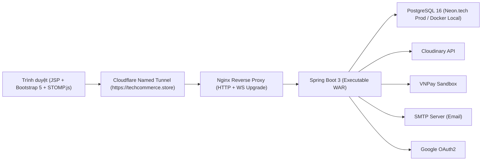
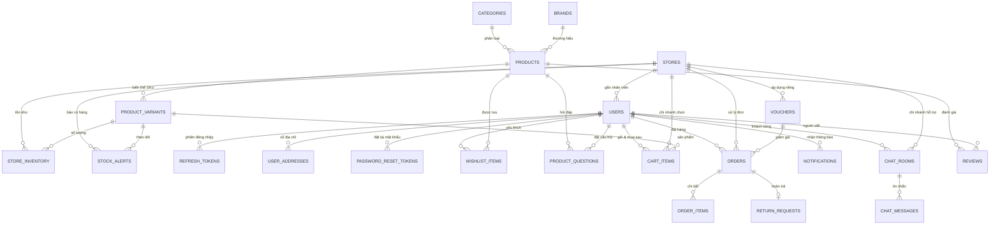

# Kế hoạch triển khai: Website bán hàng TechCommerce (mô hình chuỗi cửa hàng)

## Tổng quan

TechCommerce là hệ thống thương mại điện tử bán thiết bị công nghệ vận hành theo mô hình chuỗi cửa hàng. Khách hàng chọn chi nhánh để xem tồn kho thực tế, dự kiến thời gian giao/nhận và cảnh báo sắp hết hàng; tìm kiếm sản phẩm tiếng Việt không dấu kèm gợi ý nhanh; so sánh cấu hình 2–3 máy cạnh nhau; xem lại sản phẩm vừa xem; lưu danh sách yêu thích, đăng ký báo khi có hàng lại và chuyển nhanh sang chi nhánh còn hàng. Người mua có thể thêm giỏ từ lúc chưa đăng nhập, lưu món để mua sau, bấm "Mua ngay", đăng nhập nhanh bằng Google hoặc email, chọn sổ địa chỉ, áp dụng mã giảm giá theo chuỗi/chi nhánh, thanh toán COD hoặc VNPay sandbox, theo dõi thanh tiến trình đơn hàng kèm thông báo realtime, nhắn tin trực tiếp với chi nhánh, xem/gửi đánh giá kèm ảnh thực tế + hỏi đáp Q&A và gửi yêu cầu hoàn trả trong 7 ngày. Hệ thống tuân thủ chặt bộ công nghệ: Spring Boot 3, JSP/JSTL, SiteMesh 3, Bootstrap 5, Spring Data JPA, PostgreSQL 16, JWT (Access + Refresh Token), WebSocket, Cloudinary, đóng gói Docker, CI/CD GitHub Actions (Self-hosted Runner trên máy TV1) và public qua Cloudflare Named Tunnel gắn tên miền cố định `https://techcommerce.store`. Kế hoạch triển khai chia thành 5 giai đoạn cho nhóm 4 thành viên.

## Ngăn xếp công nghệ đã chốt (giữ nguyên ràng buộc)

| Thành phần | Phiên bản / Thư viện đề xuất | Vai trò |
|---|---|---|
| Runtime & Build | Java 17 (LTS), Maven 3.9+, packaging `war` | Biên dịch và đóng gói executable WAR chạy được JSP trong Docker |
| Backend Framework | Spring Boot 3.3.x (Web, Data JPA, Security, OAuth2 Client, Validation, WebSocket, Mail, Scheduling) | Nghiệp vụ, bảo mật, đăng nhập Google, CSDL, realtime, email SMTP và tác vụ định kỳ tự hủy đơn treo |
| View & Layout | JSP, Jakarta JSTL 3.0 (`jakarta.servlet.jsp.jstl`), `tomcat-embed-jasper`, SiteMesh `3.2.2` | Render giao diện phía server và ghép layout chung |
| Frontend UI | Bootstrap 5.3, Bootstrap Icons, Chart.js, SockJS + STOMP.js | Giao diện responsive cho storefront, trang quản trị, biểu đồ và WebSocket client |
| Cơ sở dữ liệu | PostgreSQL 16 (`unaccent` + `JSONB`, Docker local khi dev; Neon.tech miễn phí cho demo chung) + Flyway | Lưu trữ quan hệ, tìm kiếm không dấu, dùng chung dữ liệu khi bật máy dự phòng |
| Xác thực | Spring Security 6 + `jjwt` 0.12.x + Google OAuth2 | Access Token ngắn hạn + Refresh Token lưu bản băm trong PostgreSQL (HttpOnly Cookie + Bearer), hỗ trợ đăng nhập nhanh bằng Google |
| Lưu trữ ảnh | Cloudinary Java SDK (`cloudinary-http44`) | Upload, tối ưu kích thước và xóa ảnh sản phẩm, chi nhánh, đánh giá, minh chứng hoàn trả |
| Email SMTP | Spring Mail (`JavaMailSender`) + `@Async` | Gửi email quên mật khẩu, xác nhận đơn hàng, thông báo có hàng lại và kết quả hoàn trả bất đồng bộ |
| Thanh toán | COD + VNPay Sandbox (HMAC-SHA512) | Thanh toán khi nhận hàng và thanh toán trực tuyến kiểm thử |
| Đóng gói, Public & CI/CD | Docker (multi-stage), Docker Compose, Nginx, Cloudflare Named Tunnel (`cloudflared` + tên miền cố định), GitHub Actions + Self-hosted Runner, GHCR | Kiểm thử tự động, build/push image, deploy container trên máy cá nhân và mở public HTTPS/WSS cố định |

## Kiến trúc hệ thống



### Cấu trúc thư mục dự án

```text
TechCommerce/
├── .github/workflows/
│   ├── ci.yml                      # Chạy Maven test & kiểm tra build khi tạo PR
│   └── cd.yml                      # Build/push Docker image -> deploy bằng Self-hosted Runner trên máy TV1
├── docker/
│   ├── nginx/default.conf          # Reverse proxy HTTP + WebSocket upgrade + X-Forwarded-*
│   └── postgres/init.sql           # (Tùy chọn) cấu hình extension nếu cần
├── Dockerfile                      # Multi-stage: maven build -> temurin-17-jre-alpine
├── docker-compose.yml              # Môi trường local (app + postgres + mailpit)
├── docker-compose.prod.yml         # Môi trường demo public (nginx + app + cloudflared -> Neon.tech PostgreSQL)
├── pom.xml
└── src/
    ├── main/
    │   ├── java/com/techcommerce/
    │   │   ├── config/             # Security, SiteMesh, WebSocket, Cloudinary, VNPay
    │   │   ├── common/             # Exception handler, Domain Events, EmailService
    │   │   ├── auth/               # AuthController, UserService, AddressService, JwtService, RefreshToken, OAuth2
    │   │   ├── store/              # StoreController, InventoryService, StockAlertService, StoreContext
    │   │   ├── catalog/            # Product, Variant, Category, Brand, Voucher, Wishlist, Compare, CloudinaryService
    │   │   ├── order/              # Cart (Guest+User+SaveForLater), Checkout (BuyNow), Order, ReturnRequest, VNPay, OrderExpiryJob
    │   │   ├── realtime/           # Notification, Chat, EventListener đẩy STOMP
    │   │   └── report/             # Review (ảnh + % sao), ProductQuestion (Q&A), RevenueReport
    │   ├── resources/
    │   │   ├── application.yml
    │   │   ├── application-dev.yml
    │   │   ├── application-prod.yml
    │   │   └── db/migration/       # Flyway: V1__..., V2__...
    │   └── webapp/
    │       ├── assets/             # css/, js/, img/
    │       └── WEB-INF/
    │           ├── decorators/     # web.jsp, admin.jsp, auth.jsp
    │           └── jsp/            # auth/, store/, catalog/, order/, chat/, admin/
    └── test/java/com/techcommerce/ # Unit tests & integration tests
```

## Thiết kế cơ sở dữ liệu cốt lõi



### Quy ước bảng và ràng buộc quan trọng

- `users`: chứa `role` (`ADMIN`, `STAFF`, `CUSTOMER`), `store_id` (NULL với khách và admin tổng, bắt buộc có giá trị với `STAFF`), `password_hash` (cho phép `NULL` với tài khoản tạo bằng Google), `auth_provider` (`LOCAL`, `GOOGLE`), `provider_id`, `failed_login_attempts` và `locked_until` (khóa tạm 15 phút sau 5 lần sai mật khẩu liên tiếp).
- `refresh_tokens`: lưu `token_hash` (SHA-256), `user_id`, `expires_at` (7 ngày), `revoked_at` để xoay vòng Refresh Token và thu hồi phiên ngay khi đổi mật khẩu, đăng xuất hoặc bị `ADMIN` khóa tài khoản mà không cần Redis.
- `password_reset_tokens`: lưu `token_hash` (SHA-256), `user_id`, `expires_at` (15 phút), `used_at` (dùng 1 lần).
- `user_addresses`: lưu sổ địa chỉ giao hàng của khách (`recipient_name`, `phone`, `address_line`, `city`, `is_default`).
- `store_inventory`: có ràng buộc `UNIQUE(store_id, variant_id)` và `CHECK (quantity >= 0)` ở mức PostgreSQL để ngăn bán âm kho.
- `vouchers`: lưu `code` duy nhất, `discount_type` (`PERCENT`, `FIXED`), `discount_value`, `min_order_amount`, `max_discount_amount`, `store_id` (NULL là áp dụng toàn chuỗi), `usage_limit`, `used_count`, `starts_at`, `ends_at`, `active` cùng ràng buộc `CHECK (used_count <= usage_limit)`.
- `wishlist_items`: lưu `UNIQUE(user_id, product_id)` để khách lưu sản phẩm yêu thích.
- `stock_alerts`: lưu `store_id`, `variant_id`, `email`, `user_id`, `notified_at`, `created_at` để gửi email tự động khi chi nhánh nhập lại hàng từ `0` lên `> 0`.
- `products`: lưu thông số kỹ thuật động (RAM, CPU, màn hình) bằng `specs_json` kiểu `JSONB` (dùng cho trang chi tiết và bảng so sánh 2–3 máy); bật extension `unaccent` để tìm kiếm tiếng Việt không dấu.
- `cart_items`: có thêm cột boolean `saved_for_later DEFAULT false` để tách mục "Lưu mua sau" ngay trên giỏ hàng mà không cần bảng riêng.
- `orders`: lưu `fulfillment_type` (`DELIVERY`, `PICKUP`), `payment_method` (`COD`, `VNPAY`), `payment_status` (`UNPAID`, `PAID`, `FAILED`, `REFUNDED`), `order_status` (`PENDING`, `CONFIRMED`, `PROCESSING`, `SHIPPING`, `READY_FOR_PICKUP`, `COMPLETED`, `CANCELLED`), `status_history_json` (`JSONB` lưu mốc thời gian từng bước cho thanh tiến trình), `voucher_id`, `voucher_code_snapshot`, `subtotal_amount`, `discount_amount`, `total_amount`, và `vnpay_txn_ref` duy nhất để đối soát IPN.
- `order_items`: lưu snapshot tên sản phẩm, tên biến thể và đơn giá tại thời điểm đặt hàng.
- `return_requests`: lưu yêu cầu hoàn trả nguyên đơn với `order_id` (`UNIQUE`), `user_id`, `store_id`, `reason`, `evidence_image_url`/`evidence_public_id` (Cloudinary), `status` (`REQUESTED`, `APPROVED`, `REJECTED`, `COMPLETED`), `restock_inventory`, `refund_amount`, `staff_note`, `created_at`, `processed_at`.
- `reviews`: có `UNIQUE(user_id, product_id, order_id)`, kèm `image_url`/`image_public_id` (Cloudinary tùy chọn) và chỉ cho phép tạo khi đơn hàng ở trạng thái `COMPLETED` (gắn nhãn "Đã mua hàng").
- `product_questions`: lưu câu hỏi công khai của khách dưới trang sản phẩm (`product_id`, `user_id`, `question`, `answer`, `answered_by`, `answered_at`, `created_at`).

## Các quyết định kiến trúc và điểm kỹ thuật cần lưu ý

1. Đóng gói `war` thay vì `jar`: Spring Boot không resolve được file trong `src/main/webapp/WEB-INF/jsp` khi đóng gói JAR thông thường. Đặt `<packaging>war</packaging>` và giữ `tomcat-embed-jasper` ở scope `compile` để vẫn chạy trực tiếp bằng lệnh `java -jar app.war` bên trong Docker container.
2. SiteMesh 3 tương thích Jakarta EE: dùng `org.sitemesh:sitemesh:3.2.2`, đăng ký bằng `FilterRegistrationBean<ConfigurableSiteMeshFilter>` chạy sau Spring Security filter. Áp dụng `web.jsp` cho giao diện khách, `admin.jsp` cho `/admin/*` và `/staff/*`, loại trừ hoàn toàn `/api/*`, `/ws/*`, `/assets/*`.
3. JWT (Access + Refresh Token), Google OAuth2, CSRF và chống thử sai mật khẩu: trình duyệt không tự đính kèm header `Authorization` khi điều hướng trang JSP. Khi đăng nhập (form thường hoặc `OAuth2AuthenticationSuccessHandler` sau khi xác nhận `email_verified = true` và `enabled = true`), server cấp Access Token 20 phút (`ACCESS_TOKEN`) và Refresh Token 7 ngày (`REFRESH_TOKEN`), cả hai đều `HttpOnly; SameSite=Lax` (bật `Secure` ở profile `prod`). `JwtAuthenticationFilter` đọc cookie trước, fallback header `Bearer`, tự xoay vòng khi `ACCESS_TOKEN` hết hạn nếu `REFRESH_TOKEN` chưa bị thu hồi trong PostgreSQL. Bật Spring Security CSRF cho mọi form JSP/AJAX và chỉ miễn trừ `/api/payments/vnpay/ipn`. Sai mật khẩu 5 lần liên tiếp khóa tạm 15 phút; xử lý an toàn trường hợp `password_hash = NULL` của tài khoản Google.
4. Trừ tồn kho, trừ lượt voucher nguyên tử và tự hủy đơn VNPay quá hạn: dùng câu lệnh SQL nguyên tử trong `@Transactional` cho cả `store_inventory` (`quantity >= :qty`) và `vouchers` (`used_count < usage_limit`). Bổ sung `@Scheduled` chạy mỗi 5 phút để tự hủy đơn `VNPAY` ở trạng thái `PENDING + UNPAID` quá 15 phút và hoàn tồn kho + lượt voucher.
5. Tiện ích mua sắm gọn nhẹ không thêm hạ tầng ngoài: giỏ hàng vãng lai (`GUEST_CART`, tối đa 20 món), sản phẩm vừa xem (`RECENTLY_VIEWED`, tối đa 8 ID) và danh sách so sánh (`COMPARE_IDS`, tối đa 3 ID đọc `specs_json`) lưu ở Cookie/HttpSession; "Lưu mua sau" dùng cột `saved_for_later` trên `cart_items`; thanh tiến trình đơn hàng dùng `status_history_json` trên `orders`; tìm kiếm không dấu dùng `unaccent` sẵn có trong PostgreSQL 16.
6. Tách rời module bằng Spring Domain Events: dùng `ApplicationEventPublisher` cho `OrderCreatedEvent`, `OrderStatusChangedEvent`, `ReturnRequestEvent` và `StockRestockedEvent`. TV2/TV3 phát event sau commit; TV1 (`EmailService`) và TV4 (`OrderNotificationListener`) lắng nghe bằng `@TransactionalEventListener(phase = AFTER_COMMIT)` để tránh phụ thuộc vòng và tránh lỗi SMTP làm rollback giao dịch.
7. WebSocket và HTTPS qua Cloudflare Tunnel + Nginx: `HandshakeInterceptor` xác thực JWT từ cookie `ACCESS_TOKEN`; kiểm tra quyền subscribe `/topic/store/{storeId}/orders` để nhân viên chi nhánh A không đọc được đơn chi nhánh B. File `nginx/default.conf` cấu hình `proxy_http_version 1.1`, `Upgrade $http_upgrade`, `Connection "upgrade"` cho `/ws` và truyền `X-Forwarded-Proto` / `X-Forwarded-Host`; bật `server.forward-headers-strategy=framework` trong `application-prod.yml`.
8. Duy trì server trên máy cá nhân TV1 với tên miền cố định `https://techcommerce.store` và dự phòng khi tắt máy:
   - Môi trường dev (`docker-compose.yml`, project `techcommerce-dev`) chạy PostgreSQL 16 + Mailpit cục bộ trên máy từng thành viên để lập trình và chạy `mvn test` độc lập, không tiêu tốn hạn mức compute của Neon.
   - Môi trường server duy trì (`docker-compose.prod.yml`, project `techcommerce-prod`) gồm `nginx` + `app` + `cloudflared` (Named Tunnel bằng `CLOUDFLARE_TUNNEL_TOKEN`), trỏ CSDL tới **Neon.tech PostgreSQL 16 (miễn phí, `sslmode=require`)** dùng chung. Không chiếm cổng `8080`/`5432` của máy dev và không cần mở port router.
   - Cấu hình HikariCP cho `prod` với `minimum-idle=0`, `idle-timeout=60000`, `max-lifetime=300000` (và tách direct URL cho Flyway nếu dùng pooled endpoint của Neon). Endpoint `/health-jsp` không truy vấn DB để UptimeRobot ping mỗi 5 phút không làm thức DB liên tục.
   - Đặt `restart: unless-stopped` cho container prod, cài GitHub Actions Self-hosted Runner dạng Windows Service trên máy TV1 (job `deploy` đặt `timeout-minutes: 5`). Khi máy TV1 lỡ tắt, thành viên dự phòng (TV2) chạy `docker compose -p techcommerce-prod -f docker-compose.prod.yml pull && docker compose -p techcommerce-prod -f docker-compose.prod.yml up -d` với cùng `.env` để tên miền hoạt động lại ngay với nguyên vẹn dữ liệu trên Neon.
9. Gửi email SMTP bất đồng bộ: cài đặt `EmailService` dùng chung trong `common/` với `@Async` (`@EnableAsync`) phục vụ quên mật khẩu, xác nhận đơn hàng, thông báo hoàn trả và báo khi có hàng lại.
10. Tiêu chuẩn bảo mật xuyên suốt (thuần stack): bật HTTP Security Headers (`X-Content-Type-Options: nosniff`, `X-Frame-Options: SAMEORIGIN`, `Referrer-Policy`) qua Spring Security/Nginx; chống IDOR bằng điều kiện `user_id`/`store_id` trực tiếp trong Repository; mọi dữ liệu người dùng trên JSP xuất qua `<c:out>`; kiểm tra nội dung ảnh thực tế bằng `ImageIO.read()` trong `CloudinaryService`; Checkout luôn tính lại đơn giá từ `product_variants` và giảm giá từ `VoucherService` ở phía server; cấu hình `limit_req_zone` trong `nginx/default.conf` chống spam `/auth/forgot-password`, đăng ký và gửi Q&A/chat.
11. Tiêu chuẩn hiệu năng và chống giật lag (không thêm hạ tầng ngoài): chọn region **Singapore (`ap-southeast-1`)** trên Neon.tech; đặt `spring.jpa.open-in-view=false`; tạo đầy đủ Index PostgreSQL trong `V1`–`V4` và dùng `@EntityGraph`/`JOIN FETCH`/DTO projection triệt tiêu lỗi N+1; bật `@EnableCaching` (Spring Cache in-memory có sẵn) cho `stores`, `categories`, `brands` kèm `@CacheEvict` khi quản trị chỉnh sửa; dùng URL transform Cloudinary (`f_auto,q_auto,w_600,c_limit` cho danh sách, `w_1200` cho chi tiết) + `loading="lazy"`; bật `gzip on` và `Cache-Control` cho `/assets/**` trên Nginx; bắt buộc phân trang `Pageable`, debounce 300ms cho autocomplete và giới hạn JVM `-Xms256m -Xmx512m` trong `Dockerfile`.

## Phân chia công việc cho 4 thành viên

| Thành viên | Vai trò chính | Package & Thư mục sở hữu | Nghiệp vụ phụ trách |
|---|---|---|---|
| TV1 | Tech Lead, Auth, Layout & DevOps | `config/` (Security, SiteMesh), `auth/`, `common/` (Events, EmailService), `decorators/`, `docker/`, `.github/` | Khởi tạo dự án, SiteMesh decorators + Bootstrap 5 khung giao diện, Spring Security + JWT (Access/Refresh Token, Google OAuth2, khóa tạm sai mật khẩu, CSRF), đăng ký/đăng nhập/quên mật khẩu (SMTP)/hồ sơ + sổ địa chỉ/quản lý nhân viên, `EmailService` dùng chung, Dockerfile, Docker Compose, Nginx + Cloudflare Named Tunnel, GitHub Actions CI + CD (Self-hosted Runner) |
| TV2 | Chuỗi cửa hàng, Catalog, Tồn kho, Voucher & Tiện ích chọn mua | `store/`, `catalog/`, `config/CloudinaryConfig`, `jsp/store/`, `jsp/catalog/`, `jsp/admin/catalog/` | `CloudinaryService` dùng chung, CRUD chi nhánh + chọn chi nhánh (cookie), CRUD danh mục/thương hiệu/sản phẩm/biến thể, tồn kho từng chi nhánh (`STAFF` chỉ sửa chi nhánh mình), tìm kiếm không dấu (`unaccent`) + autocomplete + sản phẩm liên quan + chuyển nhanh chi nhánh còn hàng + dự kiến nhận hàng/sắp hết hàng, mã giảm giá (`vouchers`), so sánh 2–3 máy (`specs_json`), sản phẩm vừa xem, Wishlist và đăng ký báo khi có hàng lại (`stock_alerts`) |
| TV3 | Giỏ hàng, Đặt hàng, Quản lý đơn, Hoàn trả & VNPay | `order/`, `config/VnPayConfig`, `jsp/order/`, `jsp/admin/orders/` | Giỏ hàng khách vãng lai (tự gộp khi đăng nhập) + thành viên + "Lưu mua sau" (`saved_for_later`), Checkout sổ địa chỉ + voucher + nút "Mua ngay" (`Buy Now`) + giao hàng/nhận tại chi nhánh, trừ/hoàn tồn kho và voucher nguyên tử, COD + VNPay Sandbox (Return URL, IPN, `@Scheduled` tự hủy đơn quá 15 phút) + email xác nhận đơn, lịch sử đơn có thanh tiến trình (`Order Tracking Stepper`) + nút "Mua lại", xử lý đơn và luồng hoàn trả hàng (`return_requests`) cho `STAFF`/`ADMIN` |
| TV4 | WebSocket Realtime, Chat, Đánh giá, Q&A & Báo cáo | `realtime/`, `report/`, `config/WebSocketConfig`, `jsp/chat/`, `jsp/admin/dashboard/` | Cấu hình WebSocket STOMP/SockJS + bảo mật JWT, thông báo realtime đơn hàng & hoàn trả (lưu DB + đẩy STOMP từ event), chat trực tuyến theo chi nhánh, đánh giá đã mua hàng kèm ảnh Cloudinary + biểu đồ % 1–5 sao + lọc theo sao/có ảnh, hỏi đáp công khai dưới sản phẩm (`product_questions`), dashboard doanh thu/đơn hàng theo chi nhánh (trừ đơn `REFUNDED`, Chart.js + xuất CSV) |

### Quy tắc phối hợp Git, biến môi trường và tránh xung đột

- Nhánh mặc định: `main` (chỉ merge khi release ổn định, kích hoạt CD deploy qua Self-hosted Runner), `develop` (nhánh tích hợp hàng ngày), nhánh tính năng đặt tên `feat/m1-auth`, `feat/m2-inventory`, `feat/m3-vnpay`, `feat/m4-chat`.
- Mọi thay đổi ở `pom.xml`, `SecurityConfig`, `decorators/`, và `db/migration/` phải được TV1 duyệt PR trước khi merge vào `develop`.
- Trước khi sang Giai đoạn 2, chốt sớm các hợp đồng dùng chung trong `common/`: `EmailService`, `DomainEvents` (`OrderCreatedEvent`, `OrderStatusChangedEvent`, `ReturnRequestEvent`, `StockRestockedEvent`), `GuestCartMerger` (interface để TV1 gọi sau đăng nhập thường/Google và TV3 cài đặt ở Task 10 không sửa vào `auth/`), `AddressService` (TV1), `CloudinaryService` và `VoucherService` (TV2).
- Quy tắc đồng bộ `.env` và bí mật: tuyệt đối không commit `.env` hay `.env.prod` lên Git; khi thêm biến mới (như VNPay, Cloudinary, Google, SMTP), thành viên commit tên biến rỗng vào `.env.example` và đặt giá trị mặc định rỗng trong `application-dev.yml` để không làm lỗi máy thành viên khác; chia sẻ bộ key sandbox dev trong kênh nội bộ nhóm; TV1 nạp giá trị thật production vào **GitHub Repository Secrets** để `cd.yml` tự sinh `.env.prod` khi deploy.
- Dải số Flyway dự kiến để tránh đụng độ:
  - `V1`: `stores`, `users`, `password_reset_tokens`, `refresh_tokens`, `user_addresses` (TV1)
  - `V2`: extension `unaccent`, `categories`, `brands`, `products`, `product_variants`, `store_inventory`, `vouchers`, `wishlist_items`, `stock_alerts` (TV2)
  - `V3`: `cart_items` (kèm `saved_for_later`), `orders` (kèm `status_history_json`), `order_items`, `return_requests` (TV3)
  - `V4`: `notifications`, `chat_rooms`, `chat_messages`, `reviews` (kèm ảnh Cloudinary), `product_questions` (TV4)
  - `V5`: seed dữ liệu mẫu 3 chi nhánh, tài khoản admin/staff/customer, sản phẩm, tồn kho và 2 mã giảm giá mẫu (TV1 + TV2 phối hợp)

#### Bảng quy ước đường dẫn URL theo thành viên (khớp `SecurityConfig` và `SiteMeshConfig`)

| Thành viên | Đường dẫn công khai / Khách hàng | Đường dẫn quản trị / API |
|---|---|---|
| TV1 | `/auth/**`, `/profile/**`, `/health-jsp`, trang lỗi `/error` (`403`/`404`/`500`) | `/admin/users/**` |
| TV2 | `/`, `/stores/**`, `/products/**`, `/compare`, `/wishlist` | `/api/products/suggest`, `/api/wishlist/**`, `/api/stock-alerts/**`, `/api/vouchers/preview`, `/admin/stores/**`, `/admin/catalog/**`, `/admin/inventory/**`, `/admin/vouchers/**` |
| TV3 | `/cart/**`, `/checkout/**`, `/orders/**`, `/returns/**`, `/payments/vnpay/return` | `/api/cart/**`, `/api/payments/vnpay/ipn` (miễn CSRF), `/admin/orders/**`, `/admin/returns/**` |
| TV4 | `/chat/**` | `/ws/**`, `/api/notifications/**`, `/api/reviews/**`, `/api/questions/**`, `/admin/chat/**`, `/admin/questions/**`, `/admin/dashboard/**` |

## Lộ trình thực hiện theo 5 giai đoạn

| Giai đoạn | Mục tiêu chặng (Checkpoint) | TV1 | TV2 | TV3 | TV4 |
|---|---|---|---|---|---|
| Giai đoạn 1 | Nền tảng, Layout & Xác thực JWT + Refresh + Google trên Docker local | Task 1, 2, 3, 4 (Bootstrap, SiteMesh, Auth/JWT/Refresh/Google, Hồ sơ/Địa chỉ/SMTP/Staff, V1) | Task 5 (CloudinaryService & CRUD chi nhánh) | Chuẩn bị schema V3, dựng entity & unit test tính tiền/giỏ | Chuẩn bị schema V4, dựng WebSocketConfig & kiểm tra STOMP |
| Giai đoạn 2 | Chuỗi cửa hàng, Catalog, Tồn kho, Voucher & Tiện ích chọn mua | Task 19 (GitHub Actions CI) + hỗ trợ duyệt PR migration & Security | Task 6, 7, 8, 9 (Catalog, Tồn kho + Tìm kiếm `unaccent`/Autocomplete/Liên quan/Dự kiến giao, Voucher, So sánh + Vừa xem + Wishlist + Báo có hàng) | Task 10 (Giỏ hàng vãng lai + thành viên + Lưu mua sau) | Task 15 (WebSocket JWT & thông báo realtime nghe event mẫu) |
| Giai đoạn 3 | Giỏ hàng, Đặt hàng (Mua ngay), Thanh toán VNPay & Hoàn trả hàng | Hỗ trợ Security/CSRF cho checkout, guest-cart merge & WS auth | Tối ưu query JPA (tránh N+1), hỗ trợ tích hợp tồn kho & voucher | Task 11, 12, 13, 14 (Checkout địa chỉ/voucher/Mua ngay/COD/email, VNPay + job 15 phút, Quản lý đơn + Stepper + Mua lại, Hoàn trả hàng) | Task 16 (Chat khách hàng – nhân viên chi nhánh) |
| Giai đoạn 4 | WebSocket hoàn chỉnh, Đánh giá/Q&A, Báo cáo & Docker Production | Task 20 (Dockerfile prod, Nginx WS, Cloudflare Named Tunnel `techcommerce.store` + Neon, CD Self-hosted Runner) | Hỗ trợ kiểm thử tích hợp tồn kho, voucher, báo có hàng & hoàn trả | Hỗ trợ đồng bộ event hoàn trả và dữ liệu đơn `REFUNDED` cho báo cáo | Task 17, 18 (Đánh giá có ảnh/phân bố sao/Đã mua + Hỏi đáp Q&A, Dashboard doanh thu trừ `REFUNDED`, Chart.js + CSV) |
| Giai đoạn 5 | Kiểm thử end-to-end, Diễn tập dự phòng & Bàn giao | Task 21 (Kiểm thử bảo mật, diễn tập chuyển máy dự phòng + rollback) | Task 21 (Seed data `V5` gồm cả voucher, kiểm thử tồn kho đa chi nhánh) | Task 21 (Kiểm thử VNPay trên `techcommerce.store`, hoàn trả, job hủy treo, đặt đồng thời) | Task 21 (Kiểm thử WebSocket WSS qua Cloudflare Tunnel + Nginx, viết `README.md`) |

## Danh sách task tổng quan

Chi tiết từng task kèm tiêu chí nghiệm thu, lệnh kiểm chứng và danh sách file nằm trong [todo.md](file:///e:/TechCommerce/tasks/todo.md).

### Giai đoạn 1: Nền tảng, Layout & Xác thực
- Task 1: Khởi tạo dự án Spring Boot 3 (WAR), PostgreSQL 16, Flyway `V1` và Docker Compose local `[TV1]`
- Task 2: Cấu hình SiteMesh 3.2 và khung giao diện Bootstrap 5 (`web.jsp`, `admin.jsp`, `auth.jsp`) `[TV1]`
- Task 3: Xác thực Spring Security 6 + JWT (Access + Refresh Token lưu PostgreSQL), đăng nhập nhanh bằng Google OAuth2, CSRF và chống thử sai mật khẩu `[TV1]`
- Task 4: Hồ sơ, sổ địa chỉ giao hàng, quên mật khẩu (SMTP) và phân quyền nhân viên theo chi nhánh `[TV1]`

### Giai đoạn 2: Chuỗi cửa hàng, Sản phẩm, Tồn kho, Mã giảm giá & Tiện ích chọn mua
- Task 5: Dịch vụ Cloudinary dùng chung và quản lý chuỗi chi nhánh + chọn chi nhánh trên storefront `[TV2]`
- Task 6: Quản trị danh mục, thương hiệu, sản phẩm, biến thể và ảnh Cloudinary `[TV2]`
- Task 7: Quản lý tồn kho theo chi nhánh, tìm kiếm không dấu (`unaccent`), autocomplete, sản phẩm liên quan, chuyển nhanh chi nhánh còn hàng và hiển thị dự kiến nhận hàng / sắp hết hàng `[TV2]`
- Task 8: Quản lý và xác thực nguyên tử mã giảm giá (`vouchers`) toàn chuỗi hoặc theo chi nhánh `[TV2]`
- Task 9: So sánh cấu hình 2–3 sản phẩm, sản phẩm vừa xem gần đây, danh sách yêu thích (`Wishlist`) và đăng ký báo khi có hàng lại (`stock_alerts`) `[TV2]`

### Giai đoạn 3: Giỏ hàng, Đặt hàng, Thanh toán & Hoàn trả
- Task 10: Giỏ hàng khách vãng lai (tự gộp khi đăng nhập), thành viên gắn chi nhánh và "Lưu mua sau" (`saved_for_later`) `[TV3]`
- Task 11: Đặt hàng (sổ địa chỉ, áp dụng voucher, nút "Mua ngay", giao tận nơi/nhận tại chi nhánh, trừ kho & voucher nguyên tử, COD + email xác nhận) `[TV3]`
- Task 12: Tích hợp VNPay Sandbox (Return URL + IPN) và `@Scheduled` tự hủy đơn chưa thanh toán quá 15 phút `[TV3]`
- Task 13: Quản lý đơn hàng cho khách (thanh tiến trình `Order Tracking Stepper` + nút "Mua lại"), nhân viên chi nhánh và quản trị tổng `[TV3]`
- Task 14: Quản lý yêu cầu hoàn trả hàng theo chi nhánh (`return_requests`, ảnh Cloudinary, tùy chọn nhập lại kho) `[TV3]`

### Giai đoạn 4: WebSocket Realtime, Đánh giá, Q&A & Báo cáo
- Task 15: Cấu hình WebSocket STOMP/SockJS kèm xác thực JWT và thông báo đơn hàng/hoàn trả realtime `[TV4]`
- Task 16: Chat hỗ trợ trực tuyến giữa khách hàng và nhân viên theo chi nhánh `[TV4]`
- Task 17: Đánh giá sản phẩm có ảnh Cloudinary (nhãn "Đã mua hàng", biểu đồ % sao, lọc) và Hỏi đáp công khai (`product_questions`) `[TV4]`
- Task 18: Dashboard báo cáo doanh thu (loại trừ đơn `REFUNDED`), đơn hàng và sản phẩm bán chạy theo chi nhánh `[TV4]`

### Giai đoạn 5: CI/CD, Docker Production, Cloudflare Tunnel & Kiểm thử hoàn thiện
- Task 19: Thiết lập GitHub Actions CI (kiểm thử và build tự động trên PR) `[TV1]`
- Task 20: Đóng gói Docker Production, Nginx WebSocket, Cloudflare Named Tunnel (`techcommerce.store` + Neon DB) và CD Self-hosted Runner `[TV1]`
- Task 21: Seed dữ liệu mẫu `V5`, kiểm thử end-to-end, diễn tập dự phòng và rà soát bảo mật `[Cả nhóm]`

## Rủi ro và biện pháp giảm thiểu

| Rủi ro | Mức độ | Biện pháp giảm thiểu |
|---|---|---|
| JSP không render được khi đóng gói Docker (404 Whitelabel) | Cao | Chốt sớm `<packaging>war</packaging>` và test chạy `java -jar target/*.war` trong Docker ngay tại Task 1 |
| Xung đột SiteMesh 3 cũ (`javax.servlet`) với Spring Boot 3 (`jakarta.servlet`) | Cao | Ghim cố định `org.sitemesh:sitemesh:3.2.2`, kiểm chứng ghép decorator ở Task 2 trước khi chia nhánh |
| Lỗ hổng CSRF khi lưu JWT/Refresh Token trong Cookie | Cao | Bật CSRF cho mọi form JSP và AJAX POST/PUT/DELETE, đặt `SameSite=Lax`, chỉ miễn trừ endpoint VNPay IPN |
| Bán vượt tồn kho hoặc vượt lượt mã giảm giá khi đặt đồng thời | Cao | Ràng buộc `CHECK` ở PostgreSQL kết hợp câu lệnh SQL `UPDATE ... WHERE` nguyên tử cho cả `store_inventory` và `vouchers` |
| Phạm vi 21 task khá dày cho nhóm 4 người | Cao | Tái sử dụng triệt để bảng và dịch vụ có sẵn (Cookie cho Compare/Recently Viewed, cột `saved_for_later` trên `cart_items`, `status_history_json` trên `orders`); ưu tiên chốt xong đường chạy chính ở Giai đoạn 1–3 trước khi đánh bóng các tiện ích phụ |
| Lỗi gửi SMTP (Gmail App Password) làm chậm/lỗi đặt hàng hoặc báo có hàng | Trung bình | Gửi email bằng `@Async` sau `AFTER_COMMIT`, ghi log lỗi và không rollback giao dịch; dùng Mailpit trên Docker local khi dev |
| UptimeRobot ping liên tục làm DB Neon Free hết giờ compute | Trung bình | Endpoint `/health-jsp` chỉ trả về trạng thái app, không gọi truy vấn DB; cấu hình HikariCP `minimum-idle=0` |
| Self-hosted Runner ngừng chạy khi tắt máy TV1 làm CD treo chờ | Trung bình | Tách job `build-and-push` (`ubuntu-latest`) và `deploy` (`self-hosted`, `timeout-minutes: 5`); hỗ trợ bật máy dự phòng TV2 với cùng `CLOUDFLARE_TUNNEL_TOKEN` |
| WebSocket ngắt kết nối hoặc lỗi redirect HTTP/HTTPS qua Cloudflare Tunnel + Nginx | Trung bình | Cấu hình `proxy_http_version 1.1`, `Upgrade`, `Connection "upgrade"`, `X-Forwarded-Proto` trong `nginx/default.conf` và bật `server.forward-headers-strategy=framework` |

## Các yêu cầu đã chốt

- Giữ nguyên 100% ràng buộc công nghệ: Spring Boot 3, JSP/JSTL, Bootstrap 5, JPA, PostgreSQL 16, SiteMesh 3, JWT, WebSocket, Cloudinary (không thêm Redis, Elasticsearch hay Message Queue).
- Public tên miền cố định `https://techcommerce.store` bằng Cloudflare Named Tunnel (`CLOUDFLARE_TUNNEL_TOKEN`) chạy Docker Compose trên máy cá nhân TV1, kết hợp UptimeRobot ping `https://techcommerce.store/health-jsp` và khả năng bật máy dự phòng TV2 tức thì.
  - Google OAuth2 Redirect URI: `https://techcommerce.store/login/oauth2/code/google` (prod) và `http://localhost:8080/login/oauth2/code/google` (dev).
  - VNPay Sandbox URL: Return `https://techcommerce.store/payments/vnpay/return`, IPN `https://techcommerce.store/api/payments/vnpay/ipn`.
  - WebSocket endpoint: `wss://techcommerce.store/ws`.
- PostgreSQL 16 chạy Docker local khi dev/test và dùng Neon.tech miễn phí cho môi trường demo chung để chuyển máy dự phòng không mất dữ liệu.
- Đã có tài khoản Cloudinary và VNPay Sandbox (nạp qua `.env` và GitHub Secrets).
- Phân quyền `STAFF`: chỉ cập nhật tồn kho, hỗ trợ chat và xử lý đơn/hoàn trả tại đúng chi nhánh được gán (`store_id`); riêng Hỏi đáp công khai sản phẩm (`product_questions` dùng chung toàn chuỗi), cả `STAFF` và `ADMIN` đều được trả lời (hiển thị nhãn "Nhân viên TechCommerce"), còn `ADMIN` có quyền xóa nội dung vi phạm.
- Đầy đủ trải nghiệm mua sắm (so sánh cấu hình, vừa xem gần đây, Wishlist, Lưu mua sau, Mua ngay, báo khi có hàng, dự kiến giao/nhận, thanh tiến trình đơn hàng, đánh giá kèm ảnh + phân bố sao + Đã mua hàng, Q&A công khai, hoàn trả hàng 7 ngày, Google OAuth2, email SMTP bất đồng bộ) trong 21 task.
